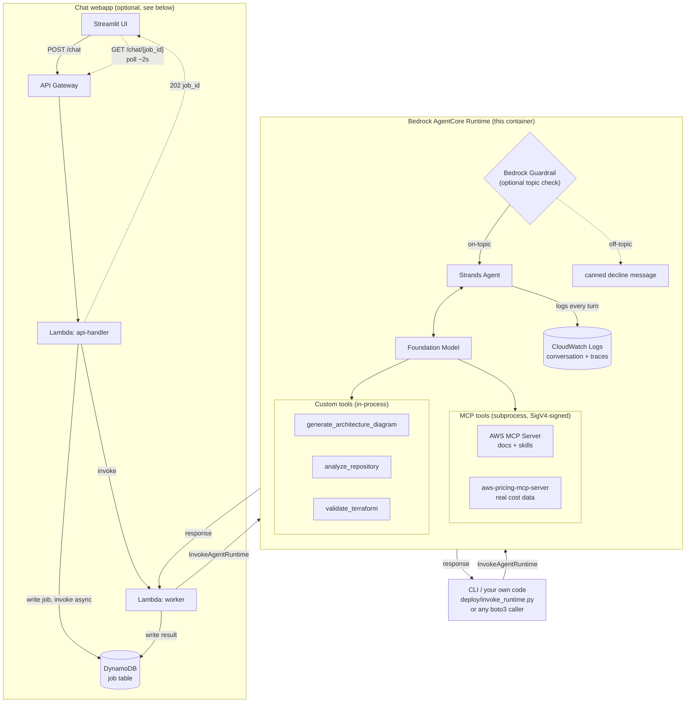
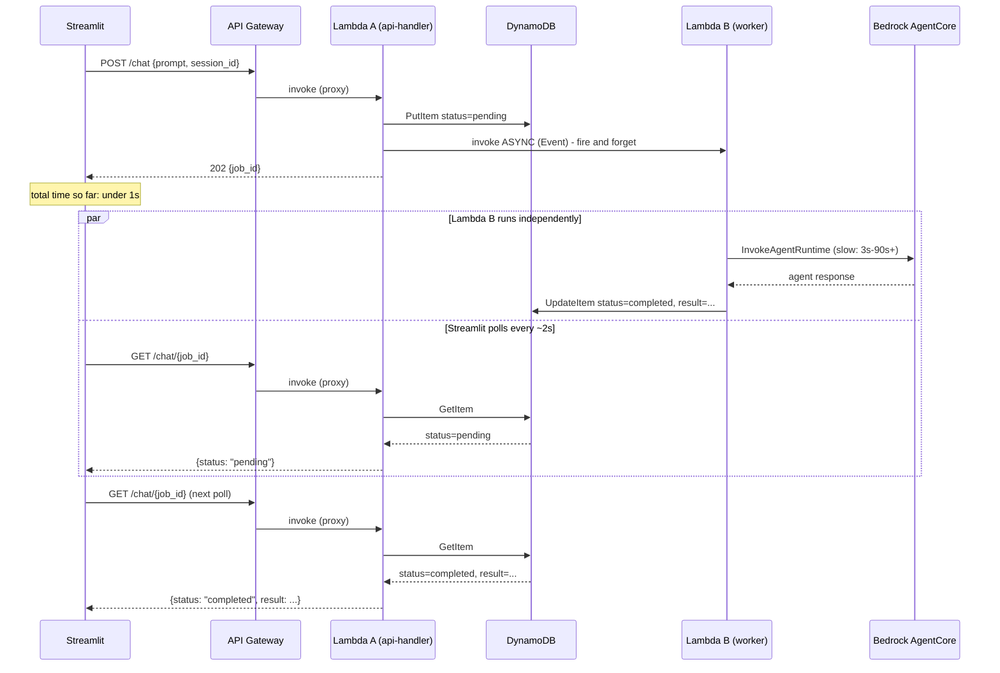

# Cloud Modernization Agent (Amazon Bedrock AgentCore)

An Amazon Bedrock AgentCore agent that helps engineers modernize AWS
workloads end to end, as a standalone, API-invocable agent (chat in, chat
out - no IDE required). Ask it to:

- **Analyze** an existing codebase and produce current-state documentation + a diagram
- **Plan** a target AWS architecture, grounded in current AWS docs/best practices, with a diagram and a real cost estimate
- **Implement** the target architecture as Terraform, validated before it's handed back to you (deployment code is always Terraform, regardless of how the request is phrased - see `agent.py`'s system prompt)

> **Model in use today:** `us.anthropic.claude-sonnet-4-5-20250929-v1:0`.
> Bedrock model IDs get retired over time - see
> [Foundation model](#foundation-model) below for how to check this model is
> still active before you deploy, and how to move to a newer version if not.

## Architecture

End-to-end flow from a user request to a response, covering both ways to
talk to the agent (a direct CLI/SDK call, or the optional chat webapp):



## Design choices

This agent is built almost entirely on official, actively-maintained
tooling rather than a grab-bag of individual MCP servers:

| Phase | Tooling | Notes |
|---|---|---|
| Analysis | `analyze_repository` + `generate_architecture_diagram` custom tools | No first-party MCP server covers repo analysis or diagram generation, so these are small, auditable custom tools |
| Planning | **AWS MCP Server** (Agent Toolkit for AWS) - `aws___search_documentation`, `aws___retrieve_skill`, `aws___run_script`, etc. - plus `awslabs.aws-pricing-mcp-server` for real cost data | AWS's current guidance is to use the officially supported **[Agent Toolkit for AWS](https://github.com/aws/agent-toolkit-for-aws)** and its single managed AWS MCP Server rather than the older, now-retired individual AWS Labs docs/knowledge servers |
| Implementation | `validate_terraform` custom tool only - deployment code is always Terraform | See below |

Real cost data uses the dedicated `awslabs.aws-pricing-mcp-server` because
the AWS MCP Server's sandboxed `aws___run_script` blocks `boto3` even for
read-only pricing lookups.

**Terraform-only implementation.** This agent deliberately never generates
CDK or CloudFormation - only Terraform, always validated with
`validate_terraform` before being shown to you. This also means it does not
run `awslabs.aws-iac-mcp-server` (the CDK/CloudFormation MCP server), which
avoids that server's `guardpycfn` dependency requiring a Rust toolchain to
compile for linux/arm64. See `config.py` for the exact MCP servers wired up
and why.

**Topic guardrail (optional).** A Bedrock Guardrail can restrict the agent
to AWS architecture/cost/Terraform questions only, rejecting everything
else before the model is ever invoked (no tokens spent on off-topic
requests). It's optional and off by default - see
[Guardrail (optional)](#guardrail-optional-topic-restriction) below.

## Foundation model

Default: **`us.anthropic.claude-sonnet-4-5-20250929-v1:0`** (Amazon Bedrock,
cross-region inference profile). Chosen by weighing cost, security/
governance, and *real measured* performance across the realistic Bedrock
candidates for this agent's heavy multi-tool workflow (docs search → pricing
lookup → diagram → Terraform validation, often several chained per request):

| Model | $/1M input | $/1M output | Tool-use reliability (this agent) | Governance |
|---|---|---|---|---|
| `amazon.nova-micro/-lite-v1:0` | $0.035-0.06 | $0.14-0.24 | Untested; same tool-calling lineage as Nova Pro (below) | AWS-native (no 3rd-party model) |
| `amazon.nova-pro-v1:0` | $0.80 | $3.20 | **Proven broken** - real CloudWatch logs show repeated `ModelErrorException: Model produced invalid sequence as part of ToolUse`, reproducible on the same multi-tool request, not fixed by disabling streaming or a retry | AWS-native |
| `amazon.nova-premier-v1:0` | $2.50 | $12.50 | Untested; same Nova tool-use lineage | AWS-native |
| `anthropic.claude-3-5-haiku` | $0.80 | $4.00 | Untested here, but a real ~3.75x-cheaper fallback if cost matters more - same vendor/tool-use lineage as Sonnet | 3rd-party model, AWS-hosted |
| **`anthropic.claude-sonnet-4-5` (default)** | $3.00 | $15.00 | **Proven working** - diagram + real pricing tool calls succeeded end-to-end (originally on Claude 3.7 Sonnet, since retired - see note below) | 3rd-party model, AWS-hosted |
| `anthropic.claude-opus-4-*` | $15.00 | $75.00 | Overkill; no evidence this task needs it | 3rd-party model, AWS-hosted |

**Security note**: Bedrock's data handling (no training on customer data,
encryption at rest/in transit, IAM/VPC-scoped access) is identical for every
model above regardless of vendor. The only real difference is
procurement/vendor-risk posture - Nova has no third-party subprocessor (it's
Amazon's own model); Claude is a third-party model hosted inside the same
AWS security boundary. This isn't a technical security gap, just a
compliance-framework nuance some organizations care about.

**Bedrock model IDs get retired over time.** This project originally
defaulted to Claude 3.7 Sonnet, which AWS fully retired (not just
deprecated - removed outright), causing real `ResourceNotFoundException:
This model version has reached the end of its life` failures in production.
Before ever changing `DEFAULT_MODEL_ID`, verify the candidate is actually
`ACTIVE` in your account/region and that it responds to a real invoke -
don't just pick an ID from memory or docs:

```powershell
aws bedrock list-foundation-models --region us-east-1 --by-provider anthropic `
  --query "modelSummaries[].{Id:modelId,Status:modelLifecycle.status}" --output table

# Write the test payload to a file - PowerShell mangles escaped inline JSON
[System.IO.File]::WriteAllText("$PWD\messages.json", '[{"role":"user","content":[{"text":"hi"}]}]', [System.Text.UTF8Encoding]::new($false))
aws bedrock-runtime converse --model-id "<candidate-id>" --messages file://messages.json --region us-east-1
```

Only update `config.py` and redeploy once that invoke actually succeeds.

Since proven reliability only exists for a current Claude Sonnet in this
agent's actual usage, that's the default. To trade reliability for cost
(after verifying the id is still `ACTIVE`):

```
BEDROCK_MODEL_ID=anthropic.claude-3-5-haiku-20241022-v1:0   # cheaper, same vendor as the proven-good default
BEDROCK_MODEL_ID=amazon.nova-pro-v1:0                         # cheapest, proven broken in this agent - not recommended
```

(Enable model access for whichever model you pick in the Bedrock console
first - see Prerequisites. `iam/execution-policy.json` already permits any
`anthropic.claude-sonnet-*` model plus Claude 3.5 Haiku, so a future Sonnet
generation bump shouldn't need an IAM change too.)

## Project layout

```
cloud-modernization-agent/
├── agent.py                 # AgentCore entrypoint + Strands Agent wiring
├── config.py                 # Model + MCP server configuration
├── mcp_setup.py               # Opens/closes the AWS MCP server tool clients
├── tools/
│   ├── diagrams.py            # generate_architecture_diagram (Mermaid)
│   ├── repo_analyzer.py        # analyze_repository
│   └── terraform_validate.py   # validate_terraform (terraform + checkov)
├── webapp/                    # Async chat webapp (Streamlit + 2 Lambdas) - see below
│   ├── streamlit_app.py         # Chat UI
│   ├── response_parsing.py       # Pure parsing logic (unit tested separately from streamlit_app.py)
│   ├── lambda_api.py             # Lambda A: POST /chat + GET /chat/{job_id} (fast path only)
│   ├── lambda_worker.py          # Lambda B: does the actual (slow) agent call
│   ├── dynamo_helpers.py         # Shared DynamoDB job-table access
│   ├── auth_helpers.py           # Shared-secret request authentication
│   └── requirements.txt
├── tests/                     # pytest unit tests for the custom tools + webapp
├── deploy/
│   ├── create_role.py          # Creates the IAM execution role
│   ├── build_via_codebuild.py    # Builds + pushes the container image via AWS CodeBuild
│   ├── deploy_runtime.py        # Creates (or updates in place) the AgentCore Runtime resource
│   ├── invoke_runtime.py         # Invokes the deployed agent (CLI, incl. --chat)
│   ├── deploy_guardrail.py       # (Optional) creates/updates the topic-restriction guardrail
│   └── deploy_webapp.py          # Creates the DynamoDB table, 2 Lambdas, and API Gateway
├── iam/
│   ├── trust-policy.json        # Who can assume the execution role
│   └── execution-policy.json     # What the role is allowed to do
├── Dockerfile                  # linux/arm64 image (required by AgentCore Runtime), built via CodeBuild - see buildspec.yml
├── requirements.txt
└── .env.example
```

## Prerequisites

1. **An AWS account** with permissions to use Bedrock, IAM, ECR, CodeBuild, S3,
   and Bedrock AgentCore (ask an admin for `AdministratorAccess` while
   learning, then scope down later).
2. **Enable model access**: AWS Console → Amazon Bedrock → Model access →
   request access to `Claude Sonnet 4.5`. This is a one-time, account+region
   setting.
3. **AWS credentials configured locally**: run `aws configure` (needs the
   [AWS CLI](https://docs.aws.amazon.com/cli/latest/userguide/getting-started-install.html)).
4. **Python 3.12+**. No local container engine is required - container
   images are built remotely via AWS CodeBuild (see "Deploy to Amazon
   Bedrock AgentCore Runtime" below).
5. Install the [`uv`](https://docs.astral.sh/uv/getting-started/installation/)
   tool locally too if you want to run the agent and its MCP servers directly
   on your machine (Step 1 below).

## 1. Run and test locally (no AWS deployment yet)

```powershell
cd cloud-modernization-agent
python -m venv .venv
.\.venv\Scripts\Activate.ps1
pip install -r requirements.txt
copy .env.example .env   # then edit values if needed
```

Start the agent's local HTTP server:

```powershell
python agent.py
```

In another terminal:

```powershell
curl -X POST http://localhost:8080/invocations `
  -H "Content-Type: application/json" `
  -d '{\"prompt\": \"Design a cost-optimized 3-tier web app on AWS, estimate the monthly cost, and give me Terraform for it\"}'
```

The first call will be slow (each MCP server is downloaded via `uvx` on
first use); subsequent calls are fast because `uv` caches the packages.

Run the unit tests (these only exercise the deterministic custom tools —
no AWS calls, no network):

```powershell
pip install pytest
pytest -v
```

## 2. Deploy to Amazon Bedrock AgentCore Runtime

> You'll need broader IAM permissions than local testing required (IAM role
> creation, ECR, S3, CodeBuild, and `bedrock-agentcore-control`). On a
> personal sandbox account, the simplest way to get these is to attach the
> AWS managed `AdministratorAccess` policy to your test IAM user via the
> console (IAM → Users → your user → Add permissions → Attach policies
> directly → search `AdministratorAccess`), then detach it again once
> deployment is done.

Amazon Bedrock AgentCore Runtime only accepts **linux/arm64** container
images. The container is built in **AWS CodeBuild**, not locally - no Docker
(or any container engine) needs to be installed on your machine. All
commands below assume PowerShell on Windows.

### Step 1 — Note your account ID and pick a region

```powershell
$ACCOUNT_ID = (aws sts get-caller-identity --query Account --output text)
$REGION = "us-east-1"   # must be a region where Bedrock AgentCore + your chosen model are available
```

### Step 2 — Create the IAM execution role

```powershell
pip install boto3
python deploy/create_role.py --role-name cloud-modernization-agent-role --region $REGION
```

This creates a role that trusts `bedrock-agentcore.amazonaws.com` and grants
the minimum permissions this agent needs: invoking the Bedrock model, pulling
its own container image from ECR, writing CloudWatch logs/traces, calling the
AWS Pricing/Cost Explorer APIs and a starter set of read-only Describe/List
actions (used by the AWS MCP Server's `aws___run_script` tool). Copy the
printed `ROLE_ARN` value. See `iam/execution-policy.json` for the full list,
and narrow or extend the `AwsMcpServerResourceDiscovery` statement to match
the AWS services you actually want the agent to inspect. Re-running this
script is safe any time you change `iam/execution-policy.json` - it updates
the role's policy in place.

### Step 3 — Build and push the container image

```powershell
python deploy/build_via_codebuild.py --repo-name cloud-modernization-agent --region $REGION
```

This creates (if they don't already exist): an S3 bucket to stage the source
zip, an ECR repository, an IAM role for CodeBuild, and a CodeBuild project;
then it starts the build (defined in `buildspec.yml`, using the `Dockerfile`)
and polls until it finishes, printing the final `IMAGE_URI` to use in the
next step. It typically takes a few minutes.

### Step 4 — Create (or update) the Agent Runtime

```powershell
python deploy/deploy_runtime.py `
  --image-uri "$ACCOUNT_ID.dkr.ecr.$REGION.amazonaws.com/cloud-modernization-agent:latest" `
  --role-arn "arn:aws:iam::${ACCOUNT_ID}:role/cloud-modernization-agent-role" `
  --region $REGION
```

Copy the printed **Agent Runtime ARN** — you'll need it for every invocation.
This script is idempotent: if a runtime with the same `--runtime-name`
already exists, it's updated in place with the new image (same ARN, nothing
else to re-wire) instead of failing.

### Step 5 — Invoke your deployed agent

```powershell
python deploy/invoke_runtime.py `
  --runtime-arn "arn:aws:bedrock-agentcore:${REGION}:${ACCOUNT_ID}:runtime/cloud_modernization_agent-XXXXXXXX" `
  --prompt "Analyze this legacy monolith and propose a target AWS architecture" `
  --region $REGION
```

### Follow-up questions (chatbot-style conversations)

This agent supports multi-turn conversations: calls that share the same
`runtimeSessionId` continue the same chat, with earlier messages (including
tool results like diagrams/pricing/Terraform) replayed to the model so
follow-ups don't repeat work already done. A new random session id is used
for a truly fresh conversation.

**Interactive CLI chat** — easiest way to try this out:

```powershell
python deploy/invoke_runtime.py `
  --runtime-arn "arn:aws:bedrock-agentcore:${REGION}:${ACCOUNT_ID}:runtime/cloud_modernization_agent-XXXXXXXX" `
  --region $REGION `
  --chat
```

Type a message, see the response, then ask a follow-up (e.g. "now show me
the Terraform for that") — it will remember the architecture from your
first message.

**Scripted / single-shot calls** — pass the same `--session-id` (33+
characters) on each call instead of letting one be generated automatically:

```powershell
python deploy/invoke_runtime.py --runtime-arn $RUNTIME_ARN --region $REGION `
  --session-id "my-fixed-session-id-1234567890" --prompt "Design a static website on S3"
python deploy/invoke_runtime.py --runtime-arn $RUNTIME_ARN --region $REGION `
  --session-id "my-fixed-session-id-1234567890" --prompt "Now give me the Terraform for it"
```

**AWS Console Test playground** — each browser chat session already reuses
one session id across the messages you send in it, so follow-ups there work
the same way without any extra setup.

**Limitation:** conversation history is held in the running container's
memory only (see `agent.py`'s `_session_messages`), not in a durable store -
it's lost if the container restarts or a later turn lands on a different
instance, and it's capped at `AGENT_MAX_SESSIONS` (default 50) concurrent
sessions to bound memory use. That's fine for interactive testing and demos;
for conversation history that survives restarts/scaling, use
[AgentCore Memory](https://docs.aws.amazon.com/bedrock-agentcore/latest/devguide/memory.html)
(the `bedrock_agentcore.memory` client already in `requirements.txt`'s
dependency tree) instead.

### Redeploying after a code change

Repeat Steps 3 and 4: rebuild the image, then re-run `deploy_runtime.py`
with the same `--runtime-name` (the default). It updates the existing
runtime in place - same ARN, nothing else to re-wire (webapp, saved ARNs,
etc. all keep working unchanged).

## 3. Chat webapp (Streamlit + API Gateway + Lambda)

A browser-friendly alternative to `invoke_runtime.py --chat` — a Streamlit
chat UI, publicly reachable behind an API Gateway HTTP API, with no AWS
credentials ever touching the browser.

### Why two Lambdas, not one

API Gateway has a hard, non-configurable **~29-second integration timeout**
that cannot be raised no matter how a Lambda's own timeout is configured.
This agent can legitimately take 3-90+ seconds depending on the request
(e.g. Terraform generation with validation). So instead of one Lambda that
waits on the agent synchronously (which would time out on exactly the
slower, more interesting requests), this uses an async "ticket number"
pattern:



`POST /chat` returns almost instantly (writes a DynamoDB record, fires off
Lambda B asynchronously via `InvocationType="Event"`, returns a `job_id`) —
it's Lambda B, which nothing is waiting on synchronously, that's allowed to
take as long as the agent needs. DynamoDB is the only way the two separate,
stateless Lambda invocations can hand off information to each other and to
repeated polling requests.

### Access control

HTTP APIs (API Gateway v2) don't support the classic "API Gateway API Keys +
Usage Plan" feature (that's REST API / v1 only). Instead, `lambda_api.py`
checks a shared secret sent as the `x-api-key` header, using a timing-safe
comparison. Keep this secret private — anyone with it can invoke your agent
and run up Bedrock costs.

### Deploy the backend

```powershell
cd "<path-to-this-repo>/cloud-modernization-agent"
.\.venv\Scripts\python.exe deploy/deploy_webapp.py --agent-runtime-arn "<your-agent-runtime-arn>" --region us-east-1
```

This creates the DynamoDB table, both Lambda functions' IAM roles, deploys
both Lambda functions, and creates the HTTP API + routes. It prints
`API_BASE_URL` and `API_SHARED_SECRET` at the end — save both.

### Run the Streamlit app locally

```powershell
pip install -r webapp/requirements.txt
$env:API_BASE_URL = "<the API_BASE_URL printed above>"
$env:API_SHARED_SECRET = "<the API_SHARED_SECRET printed above>"
streamlit run webapp/streamlit_app.py
```

(You can also paste the URL/key directly into the sidebar instead of using
environment variables.) Each browser session gets its own conversation
`session_id`, so follow-up questions continue the same agent conversation,
same as the CLI `--chat` mode. Click "Start a new conversation" in the
sidebar to reset it.

## Guardrail (optional topic restriction)

By default the agent will try to answer anything. To restrict it to AWS
architecture/cost/Terraform questions only - rejecting everything else
*before* the model is even invoked (no tokens spent on off-topic requests) -
provision a Bedrock Guardrail and wire it in:

```powershell
python deploy/deploy_guardrail.py --region $REGION
```

This creates (or, on a re-run, updates) a guardrail with a few DENY topics
(general knowledge questions, creative writing requests, personal advice)
and publishes a new version, printing `GUARDRAIL_ID` and `GUARDRAIL_VERSION`.
Pass both into `deploy_runtime.py`:

```powershell
python deploy/deploy_runtime.py --image-uri <image> --role-arn <role> `
  --env GUARDRAIL_ID=<printed id> --env GUARDRAIL_VERSION=<printed version>
```

**If you edit the topic list**, verify your changes against this agent's
own system prompt before redeploying - Bedrock sends the system prompt
through the guardrail on every call too, so a topic definition that's too
broad can end up blocking the agent's own instructions (and therefore every
request). Check with Bedrock's `ApplyGuardrail` API directly, which reports
exactly which topic matched:

```python
import boto3, agent
client = boto3.client("bedrock-runtime", region_name="us-east-1")
resp = client.apply_guardrail(
    guardrailIdentifier="<id>", guardrailVersion="<version>", source="INPUT",
    content=[{"text": {"text": agent.SYSTEM_PROMPT}}],
)
print(resp["action"])  # must be "NONE" - anything else means a topic is too broad
```

## Observability (all conversations logged)

The Dockerfile already runs the app under `opentelemetry-instrument` with
`aws-opentelemetry-distro` installed, so traces/metrics show up automatically
in **CloudWatch → GenAI Observability** - no code changes needed for that
part. On top of that, `agent.py` emits one structured JSON log line per
conversation turn (`{"event": "conversation_turn", "session_id", "prompt",
"response", "warning"}`), so every conversation is directly queryable in
CloudWatch Logs Insights (`fields prompt, response | filter event =
"conversation_turn"`) regardless of the trace pipeline.

One-time account setup (needed before any of the above appears anywhere):
enable CloudWatch Transaction Search - CloudWatch console → Application
Signals (APM) → Transaction search → Enable (select "ingest spans as
structured logs"). Equivalent CLI:
```
aws logs put-resource-policy --policy-name AgentCoreTransactionSearch --policy-document file://transaction-search-policy.json
aws xray update-trace-segment-destination --destination CloudWatchLogs
```
(`transaction-search-policy.json` is the X-Ray-to-CloudWatch-Logs resource
policy from [AWS's docs](https://docs.aws.amazon.com/bedrock-agentcore/latest/devguide/observability-configure.html#observability-configure-builtin-cw) - it's account-level, not specific to this agent.)

`deploy/deploy_runtime.py` bakes in one env var by default (override with
`--env` if you ever need to): `AWS_GENAI_CONTENT_EXTRACTION_OPT_OUT=true`,
which keeps full model/tool payloads on spans instead of ADOT's default
redaction.

(A per-agent-own-log-group span destination, via
`UNIFIED_TRACES_DESTINATION_ENABLED`, was evaluated but intentionally not
used - it requires `aws-opentelemetry-distro>=0.18.0`, which triggers a
severe pip dependency-resolver backtrack against `bedrock-agentcore` in a
clean install. Not worth the build fragility for a nice-to-have: spans
still land in the account's shared `aws/spans` log group either way, and
the conversation_turn log line above already gives a complete record
independent of this.)

## Security notes

- The execution role (`iam/execution-policy.json`) is scoped to only what
  this agent's tools need — it cannot create/modify/delete any AWS
  resources, only read pricing/cost data, make a starter set of read-only
  Describe/List calls, and invoke the foundation model.
- The AWS MCP Server authenticates to AWS using this container's own IAM
  execution role (SigV4, via the MCP Proxy for AWS CLI) — no separate
  credentials are embedded anywhere. It also tags every request with the
  `aws:ViaAWSMCPService` / `aws:CalledViaAWSMCP` IAM condition keys, so you
  can write policies (e.g. an SCP) that apply only to agent-originated calls
  if you need stricter organization-wide guardrails. See the
  [security blog post](https://aws.amazon.com/blogs/security/understanding-iam-for-managed-aws-mcp-servers/)
  for details.
- `analyze_repository` never reads the filesystem or network itself — you
  (or the client calling this agent) must pass in file contents explicitly.
  This avoids turning the agent into an arbitrary file/URL fetcher.
- `validate_terraform` runs `terraform` and `checkov` against a throwaway
  temp directory with `-backend=false`; it never applies infrastructure.
- Rotate/replace the IAM role's inline policy (`iam/execution-policy.json`)
  if you add or remove MCP servers in `config.py`, since each server may
  need its own AWS permissions.

## Troubleshooting

| Symptom | Likely cause |
|---|---|
| `AccessDeniedException` calling the model | Model access not enabled in Bedrock console for that model/region |
| Agent responses omit docs/skills/cost data | The AWS MCP Server or awslabs.aws-pricing-mcp-server failed to start; check CloudWatch logs for `"An MCP server failed to start"` warnings |
| `ExpiredTokenException` / `No AWS credentials found` from the AWS MCP Server | The execution role's temporary credentials weren't available to the container's credential chain; verify the runtime's IAM role is attached correctly (see [AWS's own auth troubleshooting table](https://docs.aws.amazon.com/agent-toolkit/latest/userguide/getting-started-aws-mcp-server.html#troubleshooting-auth-errors)) |
| Cost/pricing answers seem missing or limited | The AWS MCP Server (`https://aws-mcp.us-east-1.api.aws/mcp`) is currently only available in `us-east-1` and `eu-central-1`; `config.py` always connects to the `us-east-1` endpoint regardless of `AWS_REGION` (the `--metadata AWS_REGION=...` flag only sets the default *target* region for the API calls it makes on your behalf) |
| `validate_terraform` says both CLIs are missing | You're running outside the deployed container (e.g. `python agent.py` on a machine without `terraform`/`checkov`); set `ENABLE_TERRAFORM_VALIDATION=false` locally if you don't need it |
| `build_via_codebuild.py` fails or the build status is `FAILED` | Check the printed CloudWatch logs link for the actual build error - usually a `requirements.txt` dependency conflict (run `pip install --dry-run -r requirements.txt` locally first) or an IAM permission gap for the CodeBuild role |
| Guardrail blocks a clearly on-topic question | A DENY topic's definition is too broad, or it matches the agent's own system prompt - see [Guardrail](#guardrail-optional-topic-restriction) above for how to verify topic definitions with `ApplyGuardrail` directly |
| First request very slow / times out | Cold start downloading MCP server packages via `uvx`; the Dockerfile pre-warms the cache, but first-ever cold start can still take 20-30s |
